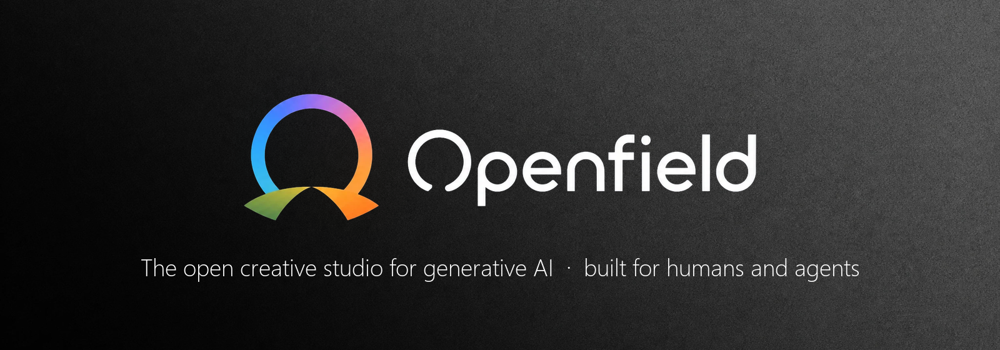

<div align="center">



# Openfield

**One studio for every AI model — on your desktop, under your control, and ready for your agents.**

</div>

> **Why Openfield?** Hosted AI platforms lock you into one catalog, one credit system and one browser tab, and they keep your generations on their servers. Openfield brings **Kie.ai, Fal.ai, Replicate, APIMart, Higgsfield, MachGen, ElevenLabs and more** into a single desktop app with your own API keys: you pay provider prices with no markup, compare costs model by model, and every image, video and track lands in a **local library you own**, with its prompt, parameters and references.
>
> **Built to pair with AI agents.** A local MCP server exposes the whole studio — library, Playground, references, variants and storyboards — so Claude Code, OpenCode or any MCP client can browse your assets, generate with your references, queue variants and hand you the results, while you review everything visually in the app. Your agent writes the brief; Openfield gives it hands, eyes and memory for media.

<div align="center">

[](https://github.com/tomaslefever/openfield/releases)
[](https://github.com/tomaslefever/openfield/releases)
[](https://www.electronjs.org/)
[](https://react.dev/)
[](https://www.typescriptlang.org/)
[](LICENSE)

*An all-in-one local-first desktop application uniting state-of-the-art AI generation providers into a streamlined, professional audiovisual production suite.*

</div>

---

## 🌟 Overview

**Openfield** is a high-performance desktop workstation designed for creators, filmmakers, and digital artists. It unifies cloud AI providers (Kie.ai, Fal.ai, Replicate, APIMart, Higgsfield, MachGen, ElevenLabs, OpenRouter) with local inference engines, giving you complete control over prompts, multi-modal references, camera directions, voiceovers, music, and multi-scene storyboard pipelines directly on your machine.

---

## ✨ Key Features

### 🎬 Content Studio (Short Drama & Mini-Series Pipeline)
A structured, end-to-end 5-stage automated & interactive production studio:
1. **Stage 1 — Script & Scene Breakdown**: Generate or import scripts, breakdown scenes into beats, and produce structured shot lists with AI assistance.
2. **Stage 2 — Characters & Props**: Define consistent character profiles, reference sheets, style tokens, and prop assets.
3. **Stage 3 — Storyboard, Frames & Audio**: Generate visual keyframes shot-by-shot with synchronized ElevenLabs voice narration and prompt enhancements.
4. **Stage 4 — Video Animation & LipSync**: Animate keyframes using leading video models (Kling, Wan 2.1, Luma Dream Machine, Sora, Hailuo) and apply speech lipsync.
5. **Stage 5 — Assembly & Export**: Review timeline sequences, preview rendered shots, and export complete production archives (ZIP).

### 🎨 Generation Playground (Image & Video)
- **Advanced Prompt Composer**: Fine-tune prompt formatting, negative prompts, seed reproducibility, and resolution parameters.
- **Cinematographic Camera Controls**: Direct shot types (Close-up, Wide, Aerial), camera angles, movement patterns (Pan, Dolly, Orbit, Zoom), lens focal lengths, and speeds directly from the UI.
- **Multi-Reference Guidance**: Attach image, video, and audio reference tokens directly into prompts for style transfer and subject consistency.
- **Aspect Ratio Matrix**: Instant switching between 1:1, 16:9, 9:16, 4:3, 21:9, and custom dimensions.

### 🎙️ Voice Generation Studio
- **ElevenLabs Integration**: Deep integration with ElevenLabs voice synthesis, custom voice clones, and voice design.
- **Multi-Language & Accent Selector**: Filter through dozens of languages and regional accents.
- **Built-in Microphone Recording**: Record custom scratch tracks or voice prompts with live waveform visualization.
- **Audio Waveform Trimmer**: Non-destructive audio trimming, playback controls, and export directly within the desktop app.

### 🎵 Music Generation Studio
- Dedicated interface for generating original background music and soundscapes.
- Genre, instrumentation, BPM, lyrics, and mood conditioning.

### 🗃️ Local Asset Library & Workspaces
- **Local SQLite Engine**: Fast, persistent storage of all generated assets, metadata, generation parameters, models, and timestamps.
- **Virtualized Grid**: Smoothly browse thousands of assets at 60fps with infinite scrolling and custom zoom levels.
- **Bulk Operations**: Multi-select assets for bulk tagging, batch deletion, and **one-click bulk ZIP export**.
- **Side-by-Side Inspector**: Detailed preview modal with metadata inspection, prompt copying, seed reuse, and download.
- **Workspace Hub**: Organize independent projects with isolated asset libraries and configurations.

### 🔌 Model Context Protocol (MCP) Server
- Built-in HTTP MCP bridge (`openfield-storyboard-bridge`).
- Allows external AI assistants (Claude, OpenCode, Antigravity) to introspect installed endpoints, query available models, orchestrate storyboards, and trigger generations autonomously.
- Playground parity: browse the library (`list_assets`, `get_asset`), generate with references or reuse the references of any previous generation (`generate`), recreate a generation with overrides (`recreate_generation`), queue up to 4 variants and preview them numbered to pick one (`wait_for_tasks` / `preview_assets`), and manage assets (`update_assets`, `delete_assets`, `import_asset`).
- Timeline editing: an agent can cut a whole montage through MCP, without touching the UI. The timeline is stored by the main process, and every edit shows live in the open **Timeline** page, so you can review it or screen-record it there. See [Timeline tools](#timeline-tools-mcp) below.
- Local-only: requests from non-loopback hosts or web origins are rejected.
- Listens on `http://127.0.0.1:19877/mcp` by default (port and on/off switch in **Settings**). For example, with Claude Code:
  ```bash
  claude mcp add --transport http openfield http://127.0.0.1:19877/mcp
  ```

#### Timeline tools (MCP)

A timeline holds ordered tracks (`caption`, `video`, `audio`) with clips placed in seconds. The first video track renders on top and the first caption track sits highest. Every call returns stable ids plus the timeline's `rev` and `duration`. Create calls accept your own `id`, so retrying one returns the existing object instead of adding a duplicate. Mistakes come back as plain errors: an unknown asset or clip, an asset that is still generating, an in/out point past the end of the source, or an overlap on a track (the error names the nearest free start).

| Tool | What it does |
|---|---|
| `timeline_list` · `timeline_get` | List the timelines of the active workspace, or read one in full: tracks, clips, start/end, in/out, volume, caption text, duration and output resolution. |
| `timeline_create` · `timeline_update` · `timeline_delete` | Create a timeline (`aspect` `16:9`, `9:16`, `1:1`, `4:5` or `4:3`; 1080 px on the short side), rename it or fix its aspect, or delete it (needs `confirm_name`). |
| `timeline_open` | Show a timeline in the app's Timeline page. |
| `timeline_add_track` · `timeline_update_track` · `timeline_remove_track` | Add, rename, mute, set the volume of every clip on a track, reorder (`index`, 0 = top), or remove a track. Caption tracks take a `caption_style` (`classic`/`social`), `highlight` and `caption_y` (vertical centre, px). |
| `timeline_add_clips` | Place library assets (`asset_id`, or `"latest"` for the newest generation) with `start`, `in`/`out` or `duration`, `volume`, `opacity` and `fade_in`/`fade_out`. When `start` is omitted, the clip goes after the track's last clip. Up to 50 per call, all-or-nothing. |
| `timeline_update_clip` | Move (`start`, `track_id`), trim (`in`, `out`, `duration`), set `volume` (0 mutes) or `opacity`, set fades (`fade_in`/`fade_out` in seconds: opacity on video and images, volume on audio and on a video's own sound), set keyframes (`volume_keyframes` / `opacity_keyframes` as `{time, value}`, linear in between; they stay on the same source frames when the clip is trimmed), or change a caption's `text`. |
| `timeline_split_clip` · `timeline_remove_clips` | Split a clip at a timeline time (the first half keeps the original id), or remove clips. Removing is idempotent: ids already gone come back in `notFound`. |
| `timeline_autoducking` | The Timeline's **Autoducking** switch in one call. It detects the voices (TTS / Voice Studio clips, or tracks marked voice) and ducks every music/background audio track under them (−12 dB, 150 ms attack, 400 ms release by default). It stays on, so the dip follows later edits to the voices. `enabled: false` switches it off and keeps the settings. With no voices it fails with "No hay locuciones en el timeline". |
| `timeline_set_ducking` | Duck a music/background track under the voices: `amount_db` (default −12), `attack_ms` (150), `release_ms` (400) and `pad_before_ms`/`pad_after_ms` (100/250). Voices are the clips on tracks with role `voice` (`voice_track_ids`, or `timeline_update_track role`) plus clips marked with `timeline_update_clip voice`. TTS clips are marked as voices when they are placed, and when nothing is marked yet the TTS tracks are detected from the library. The dip is recomputed from the voice clips on every edit and multiplies the background's own volume and keyframes, never replacing them. It is the same curve in the preview and the export, and `timeline_get` shows it. `bake: true` writes it into volume keyframes so it can be edited by hand. |
| `timeline_set_composite` | Composition of a video/image clip, or of a whole video track (a layout slot every clip on it inherits and may override). It covers: box position and size in output-frame pixels, `fit` (`contain` / `cover` / `fill`), `scale` (zoom inside the box), `anchor_x`/`anchor_y`, `rotation`, source `crop`, rounded `radius`, `shadow`, `chroma` key (green by default, with similarity, smoothness and despill), `blur`, and `motion_keyframes` (x / y / scale / rotation, e.g. a push-in). Upper video tracks cover lower ones with real alpha compositing, and sources with alpha (VP9 webm, ProRes 4444) need no key. The preview and the export compute the same geometry. |
| `timeline_apply_layout` · `timeline_list_layouts` · `timeline_save_layout` | Layout presets, which never overwrite a montage. `new_timeline: {name}` creates a new montage from the layout: its frame (e.g. 1080×1920), the slot tracks in order with their composition and caption height, and its audio tracks (Voz, Música with ducking). With `timeline_id`, the layout is only added: the frame aspect must match, missing slots become new empty tracks, and slots can be mapped onto existing tracks that have no layout yet; nothing is moved or deleted. In the app, the same thing is **Nuevo montaje desde plantilla** in the montage menu. Built-in: `reel-avatar-recuadro`: support scenes 1080×1080 on top, a rounded and blurred room panel with a shadow below, the keyed presenter in front with the head above the panel, captions at y≈1100, and a full-screen track for hooks. Save your own from any timeline. |
| `timeline_add_captions` | Add caption segments (`text`, `start`, `end`/`duration`) to a caption track. Edit them with `timeline_update_clip` and delete them with `timeline_remove_clips`. |
| `timeline_autocaptions` | Transcribe one clip, one track or the whole sequence with ElevenLabs Scribe v2 or OpenAI Whisper. The result is a new synced caption track with options for language, line length, vertical style with word highlight, and English translation. `estimate_only: true` returns the audio length and estimated cost without spending anything. |
| `voice_list` · `voice_generate` | ElevenLabs voices: list the account's voices (optionally the public Voice Library), and generate several lines in one call, one library asset per line with prompt, voice and settings stored like the Voice Studio does (so autoducking treats them as voices). Settings default to those of the latest line made with the same voice. `estimate_only: true` returns characters, credits and the estimated cost without spending; a failing line is reported and the rest still run. |
| `timeline_export` · `timeline_export_status` · `timeline_cancel_export` | Render to MP4 with captions burned in, and by default import the file into the library. The render is a background job: poll it with `timeline_export_status` or pass `wait_seconds`. One export runs at a time across the app. |
| `timeline_export_srt` | Write one caption track, or all of them merged, as a `.srt` file. |

The editor has no transitions, so there are no transition tools. A typical flow: `import_asset` / `list_assets` → `timeline_create` → `timeline_add_clips` → `timeline_autocaptions` (estimate first) → `timeline_export` → `timeline_export_status`.

### 🔄 Automatic Updates
- In-app auto-updater powered by `electron-updater` and GitHub Releases.
- Background download, update progress monitoring, and instant restart-to-install from Settings.

---

## 🚀 Supported Providers & Models

| Provider | Supported Capabilities | Notable Models |
| :--- | :--- | :--- |
| **Kie.ai** | Text-to-Image, Image-to-Video, Video-to-Video | FLUX.1 (schnell/dev), Midjourney, Imagen 3, Kling 1.5, Wan 2.1, Luma Dream Machine, Sora, Hailuo |
| **Fal.ai** | Fast Inference, Upscaling, ControlNet | FLUX Pro, FLUX Realism, SDXL, Fast Inpainting |
| **Replicate** | Community & Open-Source Models | SDXL, Flux Schnell/Dev, AudioCraft, Whisper |
| **APIMart** | Image & Video Generation | Image and video catalog with queued tasks |
| **Higgsfield / MachGen** | Image & Video Generation | Soul Image, MiniMax H3, Seedance and more |
| **Kie.ai Audio** | Text-to-Speech & Music | ElevenLabs Multilingual v2 / Turbo 2.5, Gemini Flash TTS, Suno V6 |
| **ElevenLabs** | Voice Synthesis & Voice Design | Multilingual v2, Turbo v2.5, Flash |
| **OpenRouter** | LLM (prompt & script assistance) | Top-ranked models with balance checks |
| **Local Models** | Offline & Local Processing | Kokoro TTS, Piper TTS, Local Server Endpoints |

---

## 🛠️ Architecture & Tech Stack

- **Core**: [Electron 39](https://www.electronjs.org/) + [Node.js 22+](https://nodejs.org/)
- **Frontend**: [React 19](https://react.dev/), [TypeScript](https://www.typescriptlang.org/), [Vite](https://vite.dev/)
- **Styling & UI**: [Tailwind CSS](https://tailwindcss.com/), [shadcn/ui](https://ui.shadcn.com/), [Radix Primitives](https://www.radix-ui.com/), [Lucide Icons](https://lucide.dev/)
- **State & Data**: [Zustand](https://github.com/pmndrs/zustand), [TanStack React Query](https://tanstack.com/query), [TanStack Virtual](https://tanstack.com/virtual)
- **Database**: [Better-SQLite3](https://github.com/WiseLibs/better-sqlite3)
- **Media Engine**: Local [FFmpeg](https://ffmpeg.org/) for slicing, thumbnailing, and format conversion
- **Bundler & Packaging**: [electron-builder](https://www.electron.build/)

---

## 💻 Getting Started

### Prerequisites
- **Node.js**: v20.x or v22.x LTS
- **npm** (or yarn / pnpm)
- **Git**
- **FFmpeg** (optional, recommended on system PATH if not using bundled binary)

### Installation

1. Clone the repository:
   ```bash
   git clone https://github.com/tomaslefever/openfield.git
   cd openfield
   ```

2. Install dependencies:
   ```bash
   npm install
   ```

3. Start the development environment:
   ```bash
   npm run dev
   ```

### Project Scripts

- `npm run dev`: Starts Vite frontend and Electron main process concurrently.
- `npm run build`: Compiles TypeScript for Main, Preload, and builds Vite Renderer for production.
- `npm run typecheck`: Runs TypeScript compiler check (`tsc --noEmit`).
- `npm run lint`: Runs fast Oxlint static analysis.
- `npm run package`: Packages the desktop executable for Windows using `electron-builder`.

---

## ⚙️ Configuration

Open **Settings** inside the application to configure your API credentials:
- **Kie.ai API Key**
- **Fal.ai API Key**
- **Replicate API Token**
- **ElevenLabs API Key**
- **APIMart, Higgsfield, MachGen and OpenRouter keys** (optional)
- **Local Model URLs** (default: `http://localhost:8000`)

All credentials are saved securely in your local application data directory.

---

## 📦 Releases & Distribution

Windows installers (`.exe`), blockmaps, and `latest.yml` update feeds are published directly to the [Releases](https://github.com/tomaslefever/openfield/releases) page.

To package a new release locally:
```bash
npm run build
npm run package
```
Output binaries will be placed in the `release/` directory.

---

## 📄 License

This project is licensed under the MIT License — see the [LICENSE](LICENSE) file for details.

Developed with ❤️ by [Tomás Lefever](https://github.com/tomaslefever).
